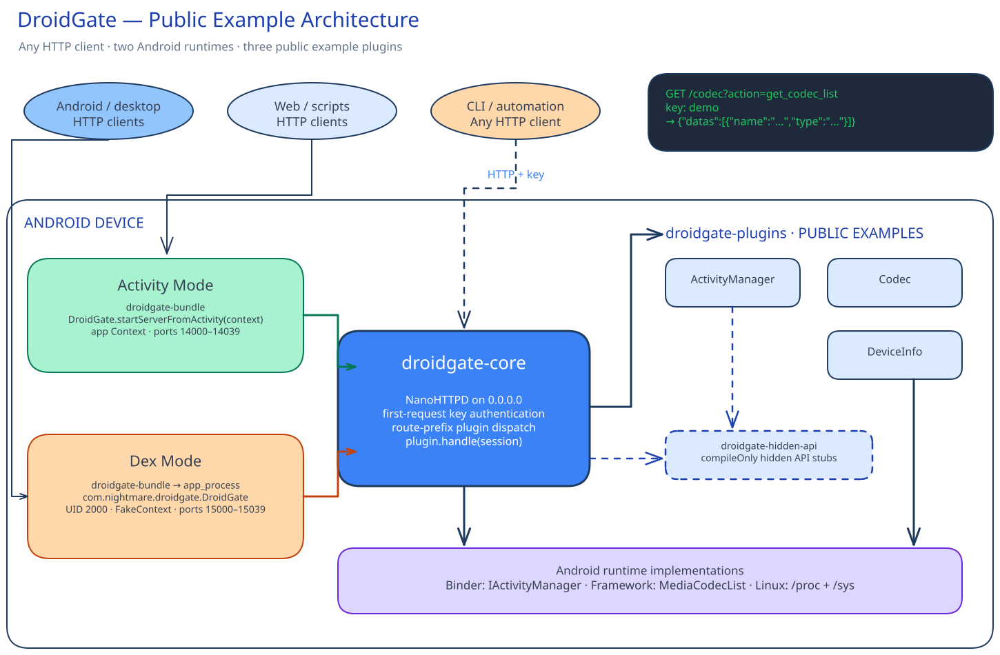

# DroidGate

[](https://jitpack.io/#nightmare-space/DroidGate)

DroidGate is a lightweight, pluggable HTTP gateway for Android framework APIs. It can run inside an Android application or as a standalone dex process started through `adb shell app_process`.

This repository contains the public foundation and a small set of example plugins. It is intended to demonstrate the plugin model, including how a plugin can call an Android hidden API through compile-time stubs.

## Public Modules

- `droidgate-core`: HTTP server, runtime context, and plugin foundation.
- `droidgate-hidden-api`: Minimal compile-time stubs required by the public examples. These classes are not packaged into the dex server.
- `droidgate-plugins`: Three example plugins: activity management, codec discovery, and device information.
- `droidgate-bundle`: Ready-to-use entry point that registers the three public example plugins.

## Public Example Routes

| Route | Purpose |
| --- | --- |
| `/activity_manager` | Start or stop an activity and remove a task through a hidden Binder API. |
| `/codec` | List codecs through public Android framework APIs. |
| `/device_info` | Read example CPU and GPU information from procfs and sysfs. |

Except for `/check`, requests must include a `key` header or query parameter. The server adopts the key from the first authenticated request and requires the same key for subsequent requests.

## Architecture



Clients only need the server address, port, and request key. A client may be written in any language that can make HTTP requests.

## Running in Dex Mode

Dex mode runs DroidGate as the Android shell user. It is useful for development and for APIs that are available to `adb shell` but not to an ordinary application process.

Requirements:

- Java 17
- Android SDK platform 35
- Android build-tools 36.1.0
- `adb` with a connected Android device
- `ANDROID_HOME` configured

Build and start DroidGate on the default device:

```bash
./scripts/build_and_run.sh
```

Select a device by serial number:

```bash
./scripts/build_and_run.sh DEVICE_SERIAL
```

The script compiles the public Java sources, creates `scripts/build/droidgate-server`, pushes it to `/data/local/tmp`, forwards TCP port `15000`, and starts it with `app_process`.

The platform and build-tools versions can be overridden when building manually:

```bash
ANDROID_PLATFORM=35 ANDROID_BUILD_TOOLS=36.1.0 ./scripts/build_without_gradle.sh
```

Check that the server is reachable:

```bash
curl http://127.0.0.1:15000/check
```

Call an example route:

```bash
curl -H 'key: demo' 'http://127.0.0.1:15000/codec?action=get_codec_list'
```

## Running in Activity Mode

Add the bundle dependency using a repository tag as the version:

```gradle
implementation 'com.github.nightmare-space.DroidGate:droidgate-bundle:v1.0.0'
```

Start the server from an Android `Context`:

```java
int port = DroidGate.startServerFromActivity(context);
```

Activity mode uses the hosting application's context and permissions. The application is responsible for its lifecycle, permissions, and network exposure.

## Developing a Plugin

Extend `DroidGatePlugin`, provide a route, and handle the incoming NanoHTTPD session:

```java
public final class ExamplePlugin extends DroidGatePlugin {
    @Override
    public String route() {
        return "/example";
    }

    @Override
    public NanoHTTPD.Response handle(NanoHTTPD.IHTTPSession session) {
        return NanoHTTPD.newFixedLengthResponse("hello from DroidGate");
    }
}
```

Register the plugin on a `DroidGateServer`, or add it to a custom bundle based on the public `droidgate-bundle` module.

Hidden API declarations belong in `droidgate-hidden-api` and should be used as compile-only dependencies. Android provides the real implementations at runtime.

## Build the Android Libraries

```bash
./gradlew \
  :droidgate-hidden-api:assembleRelease \
  :droidgate-core:assembleRelease \
  :droidgate-plugins:assembleRelease \
  :droidgate-bundle:assembleRelease
```

The public repository intentionally contains only the minimal example distribution.
